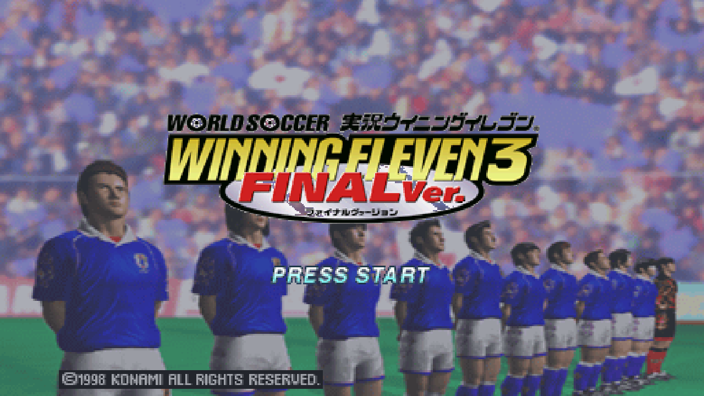
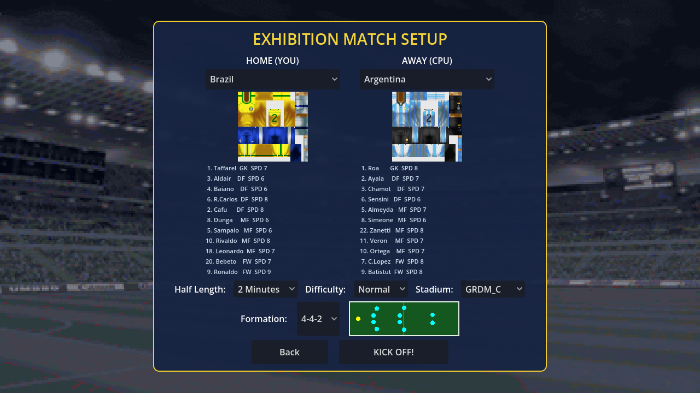
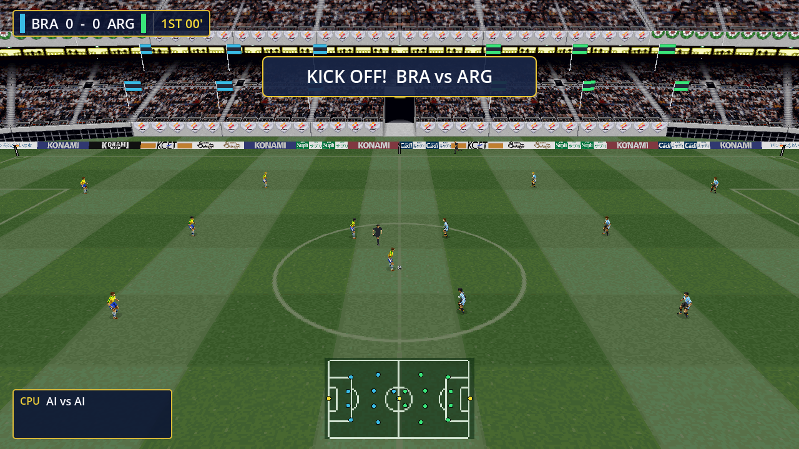

<p align="center">
  
</p>

<h1 align="center">WE3 Redux — Winning Eleven 3 Final Ver. (Godot 4)</h1>

<p align="center">
  <strong>A faithful 3D remake of PlayStation 1's <em>World Soccer: Jikkyou Winning Eleven 3 Final Ver.</em> (1998) built in Godot 4.7.2 using authentic extracted PS1 assets & reverse-engineered C gameplay logic.</strong>
</p>

<p align="center">
  <em>Bản làm lại 3D trung thực của huyền thoại PS1 <strong>Winning Eleven 3 Final Ver. (1998)</strong> trên Godot 4.7.2, sử dụng tài nguyên gốc trích xuất từ đĩa PS1 và logic vật lý/AI đối chiếu trực tiếp từ mã nguồn C decomp.</em>
</p>

<p align="center">
  <a href="#-english">🇬🇧 English</a> •
  <a href="#-tiếng-việt">🇻🇳 Tiếng Việt</a> •
  <a href="#-screenshots--hình-ảnh-minh-họa">📸 Screenshots</a> •
  <a href="#-controls--điều-khiển">🎮 Controls</a> •
  <a href="#-getting-started--cách-chạy">🚀 Getting Started</a>
</p>

---

## 📸 Screenshots / Hình ảnh minh họa

### Title Screen / Màn hình chính


### Team Select & Tactics / Chọn đội & Chiến thuật


### Live 11v11 Match Broadcast / Thi đấu 11v11 trực tiếp


---

<a id="-english"></a>
## 🇬🇧 English

### Overview
**WE3 Redux** recreates the iconic 1998 PlayStation 1 football classic *Winning Eleven 3 Final Ver.* in **Godot 4.7.2** with modern widescreen rendering while staying faithful to the original PS1 look, feel, audio, and match engine.

### Key Features
- **Authentic PS1 3D Assets**:
  - **9 Extracted Stadiums (`GRDM_C` – `GRDM_J`)**: Original PS1 stadium geometry, grass stripes, Japanese ad boards (`KONAMI`, `KCET`, `Supli`, `Cadi`), alpha-cutout stands/roofs, 3D corner flags, and waving team-colored stand flags.
  - **22 Articulated 3D Player Models & 4 Referees**: Unified 256×256 PS1 VRAM UV atlas (front/shorts kit, VRAM 576 back numbers `3–22` + GK kit, skin tone sheets, and authentic PS1 boots `tmd_60`/`tmd_61`).
  - **36 Authentic WE3 Animations**: Smoother quaternion hemisphere-continuous playback (idle, walk, run, sprint, pass, shoot, tackle, GK dive, celebrations).
  - **43 National Teams (France '98 Era)**: Full rosters, kits, colors, and team tactics (`Brazil`, `Argentina`, `France`, `Italy`, `Japan`, `Germany`, `England`, etc.).
- **Cleanly Decoded PS1 Audio**:
  - **8 Original CDDA Music Tracks** (`02TITLEV` – `09WINRUN`, 44.1 kHz stereo PCM).
  - **50 Bit-Exact SPU-ADPCM Sound Effects** decoded from `ISSPRO2A.RA` & `ISSPRO3.RA` VAB banks at exact VAB tone sample rates, including hardware-looped stadium crowd ambience (`LOOP_FORWARD` using PS1 VAG loop flags).
  - **Original Commentary Clips** decoded at native `27,781 Hz` from `VAGp` headers.
- **Reverse-Engineered Gameplay & AI**:
  - **Authentic player database (946 players)**: real shirt numbers, positions, heights and the 9 WE3 stat levels (offense, defense, speed, acceleration, kick power, technique, header, stamina, curve) read from `SLPM_861.62`. Stats drive sprint speed, acceleration, fatigue (`func_80023078`), shot power, pass/shot error window (`func_80036230`), AI shooting range and tackle strength. Each national team's lineup and formation (3-5-2, 5-3-2, 4-5-1, 3-4-3...) is derived from its real starting XI.
  - Ball physics read straight from `func_8004BAA4`: 30 Hz logic frame, gravity 736 raw/frame² (10.35 m/s²), rolling friction `h -= h>>6` plus quadratic drag, `0x5BF` bounce-stop threshold. Player motion uses the real 30 Hz model (body/move angles 12/24 units per frame, 4 while dashing, 34-unit turning cap, skid when reversing >90°).
  - Pass speed solver (`func_8002EB3C`) and defensive-third pressure clearance (`func_80033B88`) ported from the C decompilation.
  - Full match rules: kick-off, throw-ins, corners, goal kicks, fouls/cards, offside, halftime, fulltime, instant replay, and **11v11 AI vs AI** mode.
- **Classic Broadcast UI & HUD**:
  - Authentic 2-stage Title Screen → 8-mode Main Menu.
  - Scoreboard, match clock, active player nameplate (position badge, stamina, shot power bar), translucent WE3 2D radar minimap, and F12 live event log.

---

<a id="-tiếng-việt"></a>
## 🇻🇳 Tiếng Việt

### Giới thiệu
**WE3 Redux** là dự án làm lại trò chơi bóng đá huyền thoại trên PlayStation 1 — *Winning Eleven 3 Final Ver. (1998)* — bằng **Godot 4.7.2**, kết hợp hình ảnh màn hình rộng sắc nét với toàn bộ tài nguyên 3D, âm thanh, giao diện và cơ chế thi đấu chuẩn nguyên bản PS1.

### Tính năng nổi bật
- **Tài nguyên 3D nguyên bản trích xuất từ đĩa PS1**:
  - **9 Sân vận động (`GRDM_C` – `GRDM_J`)**: Mô hình sân, vạch cỏ, biển quảng cáo Nhật Bản (`KONAMI`, `KCET`, `Supli`, `Cadi`), khán đài/mái che trong suốt chuẩn PS1, cờ góc 3D và cờ cổ động trên khán đài bay theo gió mang màu áo 2 đội.
  - **22 Mô hình cầu thủ 3D & 4 Trọng tài**: Bản đồ UV thống nhất 256×256 chuẩn VRAM PS1 (áo đấu, số lưng gốc `3–22` + áo thủ môn từ VRAM 576, màu da và giày gốc `tmd_60`/`tmd_61`).
  - **36 Hoạt ảnh WE3 gốc**: Nội suy quaternion mượt mà (chạy, nước rút, chuyền, sút, xoạc bóng, thủ môn đổ người, ăn mừng…).
  - **43 Đội tuyển quốc gia thời World Cup '98**: Đầy đủ danh sách cầu thủ, bộ trang phục và chiến thuật (`Brazil`, `Argentina`, `France`, `Italy`, `Japan`, `Germany`, `England`…).
- **Âm thanh PS1 giải mã chuẩn bit**:
  - **8 bản nhạc nền CDDA gốc** (`02TITLEV` – `09WINRUN`, 44.1 kHz stereo PCM).
  - **50 hiệu ứng âm thanh SPU-ADPCM** giải mã trực tiếp từ VAB (`ISSPRO2A.RA`, `ISSPRO3.RA`) theo đúng tần số lấy mẫu từng tone, kèm tiếng khán giả sân vận động lặp mượt theo đúng điểm lặp phần cứng PS1.
  - **Giọng bình luận gốc** giải mã đúng tần số `27,781 Hz` từ header `VAGp`.
- **Vật lý & AI đối chiếu từ mã nguồn C gốc**:
  - **CSDL cầu thủ gốc (946 cầu thủ)**: số áo, vị trí, chiều cao và 9 chỉ số WE3 (tấn công, phòng ngự, tốc độ, gia tốc, lực sút, kỹ thuật, đánh đầu, thể lực, bóng xoáy) đọc trực tiếp từ `SLPM_861.62`. Chỉ số ảnh hưởng tốc độ chạy, gia tốc, mệt mỏi (`func_80023078`), lực sút, sai số chuyền/sút (`func_80036230`), tầm sút của AI và sức tranh bóng. Đội hình mỗi đội tuyển (3-5-2, 5-3-2, 4-5-1, 3-4-3...) được suy ra từ đúng 11 cầu thủ đá chính gốc.
  - Vật lý bóng đọc trực tiếp từ `func_8004BAA4`: nhịp logic 30 Hz, trọng lực 736 raw/frame² (10,35 m/s²), ma sát lăn `h -= h>>6` + lực cản bậc hai, ngưỡng dừng nảy `0x5BF`. Chuyển động cầu thủ dùng đúng mô hình 30 Hz (góc thân/góc chạy 12/24 đơn vị mỗi frame, 4 khi nước rút, trần rẽ 34, phanh trượt khi quay đầu >90°).
  - Thuật toán tính lực chuyền (`func_8002EB3C`) và phá bóng khu vực phòng ngự (`func_80033B88`) chuyển thể trực tiếp từ mã decomp.
  - Đầy đủ luật thi đấu: giao bóng, ném biên, phạt góc, phát bóng lên, phạm lỗi/thẻ phạt, hiệp 1/hiệp 2, phát lại bàn thắng (Replay) và chế độ **11v11 AI vs AI**.
- **Giao diện & HUD phong cách truyền hình 1998**:
  - Màn hình Title Screen gốc → Menu 8 chế độ chơi.
  - Bảng tỉ số, đồng hồ trận đấu, bảng tên cầu thủ đang điều khiển (vị trí, thể lực, thanh lực sút), radar sân 2D trong suốt và nhật ký sự kiện (nhấn `F12`).

---

<a id="-controls--điều-khiển"></a>
## 🎮 Controls / Điều khiển

| Action / Hành động | Keyboard / Phím |
|---|---|
| Move / Di chuyển | `W A S D` or Arrow Keys / Phím mũi tên |
| Short Pass / Switch Player — Chuyền ngắn / Đổi người | `J` / `Z` |
| Through Pass / Slide Tackle — Chọc khe / Xoạc bóng | `I` / `X` |
| Shoot / Long Clear — Sút bóng / Phá bóng | `K` / `C` (hold to charge / giữ để nạp lực) |
| Lob / Cross — Bấm bóng / Tạt cánh | `L` / `V` |
| Sprint — Tăng tốc | `Shift` |
| Pause Match — Tạm dừng | `Esc` |
| Mute / Unmute Audio — Tắt/Bật nhạc & khán giả | `M` |
| Toggle Event Log — Bật/Tắt log sự kiện | `F12` |

---

<a id="-getting-started--cách-chạy"></a>
## 🚀 Getting Started / Cách chạy

### Requirements / Yêu cầu
- **Godot Engine 4.7.2+** (Standard or Mono / .NET build).

### Run the Game / Mở game
1. Clone this repository / Tải mã nguồn:
   ```bash
   git clone https://github.com/manhtuanphoto/WE3_redux.git
   cd WE3_redux
   ```
2. Open `project.godot` in **Godot 4.7.2** and press **F5** (Play).
3. Or launch the standalone **11v11 AI vs AI** test match directly via:
   - `test_tools/ai_vs_ai_11v11.tscn` (or `test_tools/run_ai_vs_ai_11v11.bat` on Windows).

### Automated Test Suite / Chạy kiểm thử tự động
```bash
godot --headless --path . "res://tests/test_runner.tscn"
```

---

## 📁 Project Structure / Cấu trúc dự án

```text
WE3_redux/
├── assets/
│   ├── 3d/              # Stadiums (GRDM_C..J), 22 players, 4 referees, boots, ball
│   ├── animations/      # 36 extracted WE3 skeletal animations
│   ├── audio/           # 8 CDDA BGM tracks, 50 SPU-ADPCM SFX, 12 commentary clips
│   ├── database/        # 43 national teams, rosters, tactics JSON
│   └── textures/        # Team kits, back numbers, HUD, Title Screen, stadium textures
├── docs/images/         # Screenshots for README
├── scenes/              # main_menu.tscn, team_select.tscn, match.tscn
├── scripts/             # Match engine, AI, physics, HUD, stadium builder, audio manager
├── test_tools/          # 11v11 AI vs AI standalone launcher
└── tests/               # Headless automated verification suite (test_runner.tscn)
```

---

## ⚖️ Disclaimer / Lưu ý bản quyền
This is a non-commercial educational and preservation fan remake project. *Winning Eleven 3 Final Ver.* is a trademark of **Konami Computer Entertainment Tokyo (1998)**.
